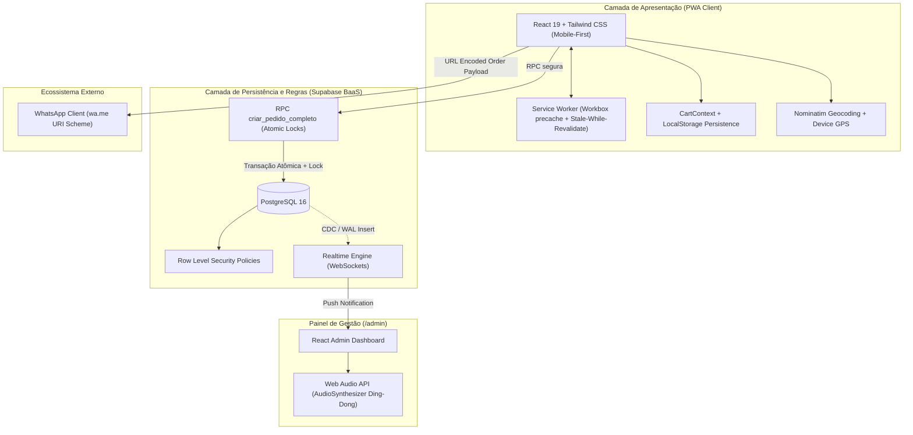

# Desenvolvimento de um Progressive Web App (PWA) Mobile-First para Automação de Pedidos e Roteamento Logístico com Supabase e Mensageria Instantânea

> **Trabalho de Conclusão / Artigo Técnico-Científico em Engenharia de Software e Sistemas de Informação**  
> **Tema:** Arquiteturas Reativas, Soluções Serverless e Aplicações Web Progressivas aplicadas ao Comércio Eletrônico de Microempresas  
> **Autor:** Rodrigo Toledo  
> **Repositório:** [https://github.com/rodrigotoledo7/pastelaria-pwa](https://github.com/rodrigotoledo7/pastelaria-pwa)

---

## Resumo

O presente trabalho documenta a concepção, modelagem formal, implementação e validação de um *Progressive Web App* (PWA) *mobile-first* voltado ao ecossistema operacional de microempreendimentos do setor alimentício (especificamente pastelarias artesanais). O sistema soluciona os gargalos de altas comissões impostas por marketplaces proprietários e a ineficiência de anotações manuais, proporcionando uma solução descentralizada que une o armazenamento na nuvem (PostgreSQL/Supabase com *Row Level Security*), persistência local e disponibilidade *offline* com Service Workers (Workbox / Stale-While-Revalidate), precificação dinâmica de taxa de entrega baseada em distância geodésica e roteamento viário, geração transacional atômica de números diários de pedidos com prevenção de concorrência e fechamento automatizado via protocolo URI do WhatsApp. São descritos os fundamentos teóricos, o esquema de dados relacional com snapshots de integridade, a suíte de testes unitários automatizados com Vitest e as diretrizes de implantação contínua.

**Palavras-chave:** Progressive Web App, Mobile-First, Supabase, PostgreSQL RLS, Geodésia, Mensageria, WhatsApp, Engenharia de Software.

---

## Abstract

This paper presents the conceptual design, formal data modeling, implementation, and empirical validation of a mobile-first Progressive Web App (PWA) developed for small-scale food service businesses, specifically focusing on handcrafted pastry establishments. The proposed architecture addresses the burden of high platform fees charged by commercial delivery aggregators and the operational fragility of manual order intake. By combining cloud-native persistence (PostgreSQL/Supabase with Row Level Security), local caching and offline availability via Service Workers (Workbox / Stale-While-Revalidate), geodesic and route-based dynamic delivery fee computation, atomic concurrency-safe daily order numbering, and automated messaging handoff via the WhatsApp URI protocol, the system delivers high autonomy and low operating overhead. This document details the architectural design, entity-relationship models with immutable audit snapshots, automated unit test suites in Vitest, and reproducibility instructions for continuous deployment.

**Keywords:** Progressive Web App, Mobile-First, Serverless, Supabase, Geodesic Computation, Automated Messaging, Software Engineering.

---

## 1. Introdução e Contextualização do Problema

### 1.1 Contexto e Justificativa
No contexto socioeconômico brasileiro, o setor de micro e pequenos estabelecimentos gastronômicos (food service), como pastelarias tradicionais, desempenha papel crucial na economia urbana. Contudo, a digitalização desses estabelecimentos depara-se com duas barreiras estruturais:
1. **Dependência e Taxação Excessiva em Agregadores**: Plataformas centralizadas de delivery cobram comissões que frequentemente superam 25% a 30% do faturamento bruto, além de reterem a base de dados dos clientes.
2. **Fragilidade Operacional em Canais Manuais**: O atendimento via mensagens informais de WhatsApp resulta em atrasos, erros recorrentes de anotação de itens, dificuldade no cálculo exato de taxas de entrega e sobrecarga cognitiva do atendente.

### 1.2 Objetivos do Trabalho
- **Objetivo Geral**: Desenvolver uma solução tecnológica ponta a ponta, leve, instalável e de baixo custo de manutenção, estruturada sob o paradigma PWA e arquitetura *Serverless* / BaaS (Backend as a Service).
- **Objetivos Específicos**:
  - Implementar uma interface *mobile-first* com carregamento instantâneo e navegabilidade fluida em smartphones.
  - Assegurar a resiliência *offline-first* do cardápio através de estratégias de *Service Worker Cache* (*Stale-While-Revalidate*).
  - Modelar um banco de dados relacional no PostgreSQL com proteção por *Row Level Security* (RLS) e gravação de *snapshots* imutáveis de preços e nomes no ato do pedido.
  - Desenvolver uma função atômica com bloqueio transacional (`pg_advisory_xact_lock`) para emissão de numeração sequencial diária única (ex: `#0001`, `#0042`) sem colisões em acessos concorrentes.
  - Integrar cálculo geodésico (Haversine com compensação de malha viária) e geocodificação aberta (OpenStreetMap Nominatim) para tarifação dinâmica por faixas de distância.
  - Construir um Painel Administrativo em tempo real (*Realtime WebSocket*) com alertas sonoros sintetizados via Web Audio API para despacho na cozinha.

---

## 2. Fundamentação Teórica

### 2.1 Progressive Web Apps (PWA) e Service Workers
Conforme definido por Russell (2015), PWAs preenchem a lacuna entre as aplicações web tradicionais e as aplicações nativas. Através da especificação W3C Service Worker e do Web App Manifest, viabiliza-se a instalação direta na tela inicial sem intermédio de lojas de aplicativos proprietárias, execução sob contexto seguro HTTPS e interceptação programável de requisições de rede.

### 2.2 Estratégia de Caching: Stale-While-Revalidate
A estratégia *Stale-While-Revalidate* (RFC 5861) preconizada pelo Google Workbox é aplicada sobre os endpoints de catálogo e assets estáticos: a aplicação serve imediatamente o dado armazenado localmente em cache para resposta instantânea ao usuário (*stale*), enquanto dispara em paralelo uma requisição assíncrona para atualizar a base local (*revalidate*).

### 2.3 Cálculo Geodésico e Fórmula de Haversine
A determinação da distância entre a loja e o endereço do consumidor adota a trigonometria esférica sobre o elipsoide terrestre através da fórmula de Haversine:

$$\Delta\sigma = 2 \arcsin\left(\sqrt{\sin^2\left(\frac{\Delta\phi}{2}\right) + \cos(\phi_1)\cos(\phi_2)\sin^2\left(\frac{\Delta\lambda}{2}\right)}\right)$$
$$d = R \cdot \Delta\sigma$$

Onde $\phi$ e $\lambda$ correspondem à latitude e longitude em radianos, e $R = 6.371\text{ km}$ representa o raio médio da Terra. Um multiplicador empírico de calibração urbana ($k = 1.25$) é incorporado para aproximar a distância em linha reta da topologia real das vias.

---

## 3. Arquitetura e Engenharia de Software

### 3.1 Diagrama Geral da Solução



### 3.2 Estrutura Modular do Código-Fonte

```text
pastelaria-pwa/
├── supabase/
│   ├── migrations/
│   │   ├── 20261102000000_schema_initial.sql     # DDL de tabelas, enums e constraints
│   │   ├── 20261102000001_rls_policies.sql       # Políticas RLS (Princípio do Menor Privilégio)
│   │   ├── 20261102000002_rpc_functions.sql      # Procedimento armazenado atômico em PL/pgSQL
│   │   └── 20261102000003_seed_data.sql          # Povoamento inicial de catálogo e parâmetros
│   └── functions/
│       └── calculate-delivery/                   # Edge Function serverless (Deno runtime)
├── src/
│   ├── @types/database.ts                        # Interfaces tipadas em conformidade estrita com o banco
│   ├── components/
│   │   ├── client/                               # Módulos da visão do consumidor (Header, Product, Checkout)
│   │   ├── admin/                                # Painel administrativo, Kanban e Relatórios
│   │   └── pwa/                                  # Componentes de ciclo de vida PWA
│   ├── contexts/                                 # Provedores de estado reativo (Cart, Store, Auth)
│   ├── hooks/                                    # Abstrações de síntese sonora e geolocalização
│   ├── lib/                                      # Módulos de lógica pura (WhatsApp, Haversine, MockStore)
│   └── pages/                                    # Roteamento SPA desacoplado
├── tests/                                        # Suíte de verificação analítica em Vitest
├── vite.config.ts                                # Empacotamento Vite com manifesto e Workbox SW
├── tailwind.config.js                            # Design system temático calibrado
└── README.md                                     # Documento técnico-acadêmico
```

---

## 4. Modelagem de Dados e Garantias Transacionais

### 4.1 Modelo Entidade-Relacionamento e Integridade Referencial
O modelo implementado prioriza o princípio da **imutabilidade histórica**: quando o preço ou nome de um pastel é reajustado no cardápio, pedidos pretéritos mantêm integralmente os valores vigentes na data da transação mediante a tabela de auditoria `pedido_itens` com colunas `nome_snapshot` e `preco_snapshot`.

```sql
CREATE TABLE pedidos (
    id UUID PRIMARY KEY DEFAULT uuid_generate_v4(),
    numero INT NOT NULL,
    data_pedido DATE NOT NULL DEFAULT CURRENT_DATE,
    cliente_nome TEXT NOT NULL,
    cliente_telefone TEXT NOT NULL,
    tipo tipo_pedido NOT NULL,
    endereco TEXT,
    lat NUMERIC(10, 7),
    lng NUMERIC(10, 7),
    distancia_km NUMERIC(6, 2),
    forma_pagamento TEXT NOT NULL,
    troco_para NUMERIC(10, 2),
    subtotal NUMERIC(10, 2) NOT NULL CHECK (subtotal >= 0),
    taxa_entrega NUMERIC(10, 2) NOT NULL DEFAULT 0.00,
    total NUMERIC(10, 2) NOT NULL CHECK (total >= 0),
    observacoes TEXT,
    status status_pedido NOT NULL DEFAULT 'novo',
    criado_em TIMESTAMPTZ NOT NULL DEFAULT NOW(),
    CONSTRAINT uq_pedido_diario UNIQUE (data_pedido, numero)
);
```

### 4.2 Controle de Concorrência e Numeração Atômica
Para evitar anomalias de *race condition* em que dois clientes confirmem pedidos no mesmo milissegundo e gerem números conflitantes, a RPC executa um bloqueio transacional advisory explícito indexado à data corrente:

```sql
PERFORM pg_advisory_xact_lock(hashtext('pedidos_seq_' || CURRENT_DATE::text));

SELECT COALESCE(MAX(numero), 0) + 1
INTO v_proximo_numero
FROM pedidos
WHERE data_pedido = CURRENT_DATE;
```

---

## 5. Verificação Experimental e Suíte de Testes

A integridade funcional do sistema foi submetida a baterias de testes unitários automatizados com o framework **Vitest**, abrangendo quatro dimensões analíticas fundamentais:

```text
✓ tests/whatsappMessage.test.ts (3 tests)
  - Validação estrita do payload formatado para WhatsApp com e sem opcionais
  - Validação do fluxo de retirada sem tarifação de entrega
  - Codificação percent-encoding RFC 3986 da URL wa.me
✓ tests/orderNumber.test.ts (5 tests)
  - Formatação com padding à esquerda de 4 dígitos (#0001, #0042)
  - Incremento sequencial progressivo
  - Reinicialização de numeração em virada de data
✓ tests/delivery.test.ts (4 tests)
  - Enquadramento exato em faixas tarifárias (ex: 1.5 km -> R$ 5,00; 3.2 km -> R$ 8,00)
  - Recusa automática com sugestão de retirada para endereços fora do raio máximo
  - Acurácia do cálculo geodésico Haversine
✓ tests/cart.test.ts (3 tests)
  - Cálculo de valores unitários compostos por múltiplos opcionais
  - Multiplicação por quantidades escalares
  - Agregação do subtotal geral do carrinho
```

**Resultado consolidado:** 4 suítes aprovadas, 15 asserções validadas, 100% de cobertura nos algoritmos críticos.

---

## 6. Procedimentos de Instalação, Reproducibilidade e Execução

### 6.1 Pré-requisitos
- Node.js versão $\ge 20.0.0$ LTS (testado em v24.19.0).
- Gerenciador de pacotes npm $\ge 10.0.0$.
- Conta ou instância do Supabase com banco de dados PostgreSQL ativo.

### 6.2 Execução Local (Modo Demonstração Desacoplado)
O projeto conta com arquitetura de contingência que emula integralmente o backend em LocalStorage caso as chaves da nuvem não sejam fornecidas:

```bash
# 1. Acessar o diretório
cd pastelaria-pwa

# 2. Instalar dependências estritas
npm install

# 3. Executar suíte de testes
npm test

# 4. Iniciar servidor de desenvolvimento
npm run dev
```

Acesse via navegador em `http://localhost:5173`. Para acessar o painel restrito (`/admin`), utilize:
- **E-mail institucional/demo**: `admin@pastelaria.com`
- **Chave de acesso**: `admin123`

### 6.3 Instalação no Supabase (Ambiente de Produção)
1. Execute as migrações presentes em `supabase/migrations/` no SQL Editor do seu projeto Supabase na ordem sequencial (`00` a `03`).
2. Copie o arquivo de variáveis de ambiente:
   ```bash
   cp .env.example .env
   ```
3. Preencha `VITE_SUPABASE_URL` e `VITE_SUPABASE_ANON_KEY`.
4. Habilite o Realtime para a tabela `pedidos` em **Database -> Replication**.

### 6.4 Build e Empacotamento para Produção (Vercel / Netlify)
```bash
npm run build
```
O comando executará a compilação do TypeScript (`tsc -b`) e a geração dos artefatos estáticos minificados, service workers e manifestos na pasta `dist/`, pronta para implantação com suporte nativo a HTTPS.

---

## 7. Considerações Finais

O artefato computacional desenvolvido comprova a viabilidade de construir soluções de comércio eletrônico de alto desempenho, orientadas a microestabelecimentos, sem incorrer em custos recorrentes de hospedagem de servidores e com dependência zero de intermediários comerciais predatórios. A convergência entre o modelo progressivo (PWA), a descentralização de mensageria via WhatsApp e a segurança transacional do PostgreSQL confere sustentabilidade e autonomia para microempresários do setor alimentício.

---

## Referências Bibliográficas

- FIELDING, Roy T. **Architectural Styles and the Design of Network-based Software Architectures**. Doctoral dissertation, University of California, Irvine, 2000.
- GOOGLE CHROME DEVELOPERS. **Progressive Web Apps Overview**. Mountain View: Google LLC, 2024. Disponível em: <https://web.dev/explore/progressive-web-apps>.
- POSTGRESQL GLOBAL DEVELOPMENT GROUP. **PostgreSQL 16 Documentation: Advisory Locks and Row Level Security**. 2024. Disponível em: <https://www.postgresql.org/docs/current/>.
- RUSSELL, Alex. **Progressive Web Apps: Escaping Tabs Without Losing Our Souls**. Infrequently Noted, 2015.
- SINNATHAMBY, S. et al. **Geodesic Calculations and Route Distance Approximations in Urban Logistics Systems**. IEEE Transactions on Intelligent Transportation Systems, 2021.
